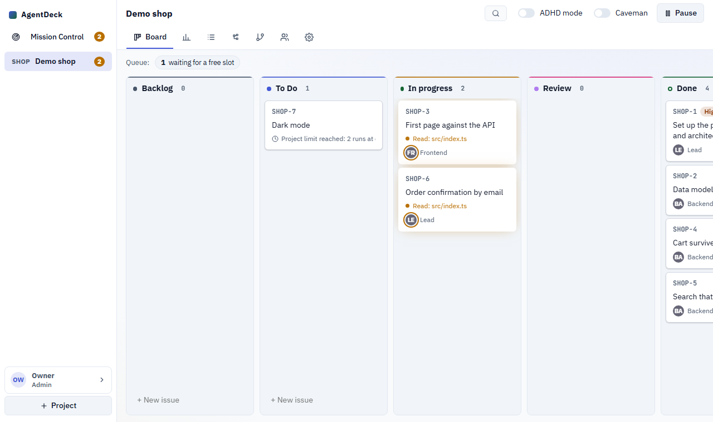

# AgentDeck

**A self-hosted issue board for AI coding agents.** Assign work to Claude Code, Codex CLI, or
OpenCode. Watch runs live, inspect diffs, and choose whether finished work stays in review,
merges locally, or opens as a pull request.

[Try the demo](#try-the-demo) · [Self-host](#quick-start) · [Star on GitHub](https://github.com/TurkishMagikarp/Agentdeck-Public-)



The board runs on Node.js and SQLite. The demo needs no API key or agent CLI; real runs use your
chosen providers.

## Try the demo

With [Node.js 24+](https://nodejs.org/) and Git installed:

```sh
git clone https://github.com/TurkishMagikarp/Agentdeck-Public-.git agentdeck
cd agentdeck
npm ci
npm run demo
```

Open <http://localhost:8798>. `npm run demo` needs neither a login nor an API key: a team from a
template works through a few issues with mock agents, so the board, Mission Control, the journal
and the statistics have something to show. Mock agents cost nothing and change no repository. The
data lives in `data-demo` and can be deleted afterwards. Press `Ctrl+C` when finished.

## What it does

- **Orchestrates work:** Give each project its own team, work queue, dependencies, and routines.
- **Keeps runs visible:** Follow live logs, inspect diffs, and see why an issue is waiting.
- **Controls what lands:** Work in Git worktrees, request reviews, and run checks before merging.

<details>
<summary>Full feature list</summary>

- **Projects instead of organizations.** Each project has its own repository, agents, board and
  settings.
- **Agents through the CLIs you already use.** Claude Code, Codex CLI and opencode run as
  subprocesses; Deepseek runs through a built-in agent loop against its API, and Claude Managed
  Agents run the agent loop at Anthropic with the tools on your server. Per provider you choose
  subscription or API key, and Claude and Codex can be logged in from the web interface.
- **Mission Control.** One page across all projects: who is working right now, what needs you,
  costs and runs of the last 24 hours, a kill switch that pauses the whole fleet, and a spend
  limit per 24 hours that pulls the kill switch by itself.
- **Templates.** Ready-made teams (SaaS MVP, game studio, blog with a daily article) create a
  project with agents, first issues and a planning routine in one step. New projects start paused.
- **One branch per issue.** Agents work in git worktrees, either one per issue or one fixed checkout
  per agent so build caches survive.
- **Sandbox.** In the container every project runs as a Linux user of its own, optionally with a
  network allowlist.
- **Reviews and landing.** Issues can go through a chain of reviewers. Finished work is merged
  locally or opened as a pull request, with checks and protected paths. A project can ask for proof
  (e.g. screenshots) before a branch that touches certain paths lands, and hold a landing for your
  approval when it adds dependencies or touches infrastructure files.
- **Arena.** Several agents work on the same issue in parallel, a jury picks the best entry, and
  only the winner is reviewed and landed.
- **Acceptance checklists and precheck.** Every issue gets a checklist from its "Done when" and the
  project's templates. The server checks proof files, merge conflicts, secrets and the check command
  before a reviewer spends a run.
- **Branch preview.** When work goes to review, AgentDeck can start the app from the issue's branch
  and take a desktop and a phone screenshot with Playwright. Owner and reviewer see the result
  without starting anything.
- **Code changes and git view.** Each issue shows its commits and diff against the base branch,
  including uncommitted work while an agent is still on it. A graph per project shows the base
  branch, one lane per issue branch, what has landed and which agent works where.
- **Dependencies and blocker priority.** Issues can wait on other issues. An issue that holds up
  others starts first, boosted by how many it holds up through the whole chain. Rings of issues
  that wait on each other are resolved: the deputy agent decides which dependency goes, otherwise
  AgentDeck removes the newest one.
- **Waiting reasons.** Every issue that does not start says why: a blocker, a retry, a busy agent,
  the project limit, no provider left, or quota being saved.
- **Self-healing.** A failed run is sorted by kind of failure. A rate limit or a broken login rests
  the provider and does not count as a failed attempt; a missing tool or an overfull context gets a
  hint for the next run; the same unexplained error twice moves the issue to another provider.
- **Lessons.** Build commands, pitfalls and tools that had to be installed are recorded per project,
  by agents, by self-healing or by you. Every run reads the newest ones.
- **Quota pacing.** AgentDeck reads how full the subscription windows are and when they reset.
  Shortly before a reset with plenty left, big issues go first.
- **Cost cap and forecast per issue.** An issue that used more than the project allows (dollars or
  tokens) is parked instead of eating everyone else's budget. You can grant it another round. Open
  issues show what similar finished issues cost.
- **Routines.** Recurring issues at a set time, e.g. a daily report, or a planner that only fires
  when nothing in the project is open.
- **Watchdog and autonomy.** Stuck issues are handed to a deputy agent or parked in the backlog, so
  nothing waits forever. A parked issue that blocks open work goes back into the queue. Run budgets
  cap what a single run may spend.
- **Live run log and run history.** Follow what an agent is doing while it works, and replay the
  prompt, tool calls, answers and changes of a finished run, without detected secrets.
- **Journal.** What happened in a project, one line per event: landings, red checks, change
  requests, escalations.
- **Issue search and issue page.** Search across all projects by key, number or words. Each issue
  has its own page with dependencies, history of changes, comments, screenshots and code.
- **Usage, outcomes and statistics.** Tokens per agent (new and cached), quotas over time, what got
  done, and what the runs achieved: per agent how much of its work landed and how often reviewers
  approved it, per model how often a run ended with a usable result.
- **Users, roles and audit log.** Extra users with a token of their own as viewer, operator or
  admin. The audit log shows who changed which settings.
- **Built-in MCP connections.** GitHub, PixelLab, ElevenLabs, Recraft and Meshy, assigned per agent.
- **AgentDeck as an MCP server.** Read the boards and create, comment on, move and stop issues
  from any MCP client.
- **GitHub issue intake and webhooks.** Issues that get a label on GitHub appear on the board;
  webhooks tell AgentDeck when the checks of a pull request finish. Outgoing webhooks report status
  changes to Slack or an endpoint of your own.
- **Prometheus metrics.** Issues, runs, costs, tokens and quotas at `/api/metrics`.
- **ADHD mode.** Per project, agents answer with one result line and at most three bullets.
- **Owner notifications.** When an issue waits for a human, AgentDeck sends a web push to your
  devices and, if set up, a mail through AgentMail.
- **Morning report.** Once a day at a set time, one look at the last 24 hours across all projects:
  one line per project, parked and finished work first. Sent by push and mail.
- **Showcase.** An optional read-only public page per project at `/show/<slug>` that shows the
  agents at work, for a demo or a job application. Never code, costs or comments.
- **Housekeeping.** Old run logs, finished branches, temp files and CLI sessions are cleaned up once
  a day; checkouts that grew too big lose their build output before their next run.
- **Skill for Claude Code.** Describe a project in one sentence and let Claude set it up in
  AgentDeck.

</details>

## Quick start

For real work, use Node.js 24+, Git, and the CLI or credentials for your chosen provider.

```sh
npm ci
npm start            # builds the UI and starts on http://localhost:8790
npm run dev:mock     # the same on port 8799, with a mock agent instead of real CLIs
npm run demo         # to look at: a ready team with mock agents on http://localhost:8798
```

`npm start` needs `AGENTDECK_TOKEN` (see [Configuration](#configuration)); for a purely local try
without a token set `AGENTDECK_ALLOW_OPEN=1`. Open <http://127.0.0.1:8790>, set up **Providers and
access**, and create a project. Point it at a trusted Git checkout or leave the repository path
empty to use a managed workspace.

> **Trust boundary:** Anyone who can administer the board can configure commands that run on the
> host or in the container. Outside the container agents share the server's execution environment;
> in the container every project runs as a Linux user of its own (see [Sandbox](#sandbox)). Use
> trusted operators and repositories, and use narrowly scoped credentials. Do not expose the demo
> or a tokenless board to a network.

## Configuration

| Variable                          | Default         | Meaning                                                                                              |
| --------------------------------- | --------------- | ---------------------------------------------------------------------------------------------------- |
| `PORT`, `HOST`                    | 8790, 127.0.0.1 | Server address                                                                                       |
| `AGENTDECK_DATA`                  | `./data`        | Database, worktrees, working folders                                                                 |
| `AGENTDECK_TOKEN`                 | empty           | Required (except with a proxy or `AGENTDECK_ALLOW_OPEN=1`); the API asks for `Authorization: Bearer …` |
| `AGENTDECK_SECRET`                | empty           | Key for the API keys stored in the database; falls back to `secret.key` in the data folder           |
| `AGENTDECK_TRUST_PROXY`           | off             | `1`: requests with a `Remote-User` header are accepted if `X-AgentDeck-Proxy` matches too            |
| `AGENTDECK_PROXY_SECRET`          | empty           | Required with `TRUST_PROXY` (at least 16 characters); the proxy sends it as `X-AgentDeck-Proxy`      |
| `AGENTDECK_PROXY_ROLE`            | `admin`         | Role of a proxy user who has no entry under Users (`viewer`, `operator`, `admin`)                    |
| `AGENTDECK_ALLOW_OPEN`            | off             | `1`: allow a start without a token (local only; automatic in mock mode)                              |
| `AGENTDECK_SANDBOX`               | off             | `1`: run every project as a Linux user of its own (Linux only; set in the Docker image)              |
| `AGENTDECK_EGRESS_PORT`           | 8791            | Port of the egress proxy for projects with a network allowlist (loopback only)                       |
| `AGENTDECK_CACHE_MB`              | 256             | SQLite page cache in RAM                                                                             |
| `AGENTDECK_MOCK`                  | off             | `1`: adds a "Mock" provider for testing without real usage                                           |
| `AGENTDECK_PUBLIC_URL`            | empty           | Public address for links in mails and as the web push sender                                         |
| `AGENTDECK_CHECKOUT_LIMIT_GB`     | 10              | Checkouts above this size lose their build output on the next run                                    |
| `AGENTDECK_GITHUB_WEBHOOK_SECRET` | empty           | Secret of the GitHub webhooks (at least 16 characters), see "Approval gates and GitHub webhooks"     |

## Running with Docker

```sh
# In a fresh checkout; do not overwrite an existing .env.
cp -n .env.example .env
# Generate a token, then paste it as AGENTDECK_TOKEN in .env.
openssl rand -hex 32
docker compose up -d --build

# log in to each CLI once; the logins are kept in the "home" volume
docker compose exec agentdeck claude
docker compose exec agentdeck codex login
docker compose exec agentdeck opencode auth login
```

Open <http://127.0.0.1:8790> and sign in with the token.

Repositories the agents should work on go to `/srv/agentdeck/repos` on the host and appear as
`/repos/<name>` in the container. That path is what you enter in the project.

The image contains Git, Node, Python 3 with venv, uv, a C compiler and a virtual display with
software OpenGL for agents that render or screenshot what they build. An agent gets system packages
with `agentdeck install <package>`; the server installs them from the Debian sources. They last
until the container is rebuilt. What is needed for good belongs in the Dockerfile. Python versions
and packages installed with uv live in the project's home under `/data/homes` and survive.

### Sandbox

In the container every project runs as a Linux user of its own (`ad-<key>`, e.g. `ad-shop`). It
owns the repository, the worktrees and its home under `/data/homes`, nothing else. Agents have no
`sudo`, read neither the database nor the keys nor the server's logins, and do not see other
projects. The server's own git commands run as the project user too, so hooks or git settings an
agent writes into the repository reach nothing outside the project.

- The server (`node`) may do only two things with sudo: start commands as a project user, and run
  `/usr/local/sbin/agentdeck-sandbox` as root (create users, install packages, stop runs). See
  `docker/sudoers` and `server/sandbox.ts`.
- Repositories under `/repos` are handed to the project user at the first start (`chown`). A
  repository belongs to exactly one project; a second project with the same path does not start.
- All projects run in the same container, separated by Linux users, not by containers of their own.
- The CLI logins stay in the server's `home` volume. Every run gets a copy; a refreshed token goes
  back afterwards and on to the other running projects. Only the token files come back, never
  settings (`.claude.json`, `config.toml`).
- The project home also gets `.gitconfig`, the gh login (also from `GH_CONFIG_DIR`, not for projects
  with a GitHub token of their own), and the server's skills, plugins and opencode configuration
  whenever they change.
- Agents install packages with `agentdeck install <package>`, not with sudo.
- For Claude, `claude setup-token` is the most robust login.
- Claude Managed Agents are disabled in the sandbox.
- Outside the container (Windows, `npm start`) the sandbox is off; `AGENTDECK_SANDBOX=1` switches
  it on under Linux.

### Network allowlist per project

In the project settings under "Network of the agents" a project can be switched from "Open" (the
default) to "Allowed hosts only". Then:

- A firewall rule (iptables/ip6tables, one rule per uid) lets the project user reach only
  `127.0.0.1` and `::1`: the AgentDeck server and its egress proxy. Everything else is rejected,
  DNS too.
- The runs get `HTTP_PROXY`/`HTTPS_PROXY` (also in lower case, `ALL_PROXY`, `NO_PROXY`) pointing at
  the proxy on `127.0.0.1:8791` (`AGENTDECK_EGRESS_PORT`). The proxy identifies the project by the
  uid of the connection (from the kernel, not from the client) and lets only listed hosts through.
- Entries: `github.com` (exactly this host), `*.example.com` (subdomains only), `host:8443`, IP
  addresses (`192.0.2.7`, `[2001:db8::1]`). Without a port, 80 and 443 apply. A host name that
  points to an internal address (loopback, private network, link-local) is rejected; internal
  targets only work as an IP entry.
- Default: the endpoints of Claude Code and Codex, GitHub, npm and PyPI. The settings page shows
  recently blocked targets so you can allow them.
- Git over SSH does not work with an allowlist, Git over HTTPS does. `agentdeck install` goes
  through the server and is not affected.

The sandbox helper sets the firewall rules (`agentdeck-sandbox egress`). For that the container
needs the `NET_ADMIN` capability, which is why `docker-compose.yml` contains:

```yaml
    cap_add:
      - NET_ADMIN
```

Without it (or without iptables in the image) the project stays open, the server writes that to
its log and the settings page shows "Firewall not available". The capability only applies to root
in the container, that is to the helper; the server and the agents run without it.

### Behind a reverse proxy

The compose file binds the port to 127.0.0.1. Put a reverse proxy with authentication in front
(e.g. nginx with Authelia or oauth2-proxy). Live events need unbuffered responses:

```
location / {
    # … your login in front, e.g. Authelia or oauth2-proxy …
    proxy_pass http://127.0.0.1:8790;
    proxy_set_header Remote-User $user;
    proxy_set_header X-Real-IP $remote_addr;
    proxy_set_header X-AgentDeck-Proxy <AGENTDECK_PROXY_SECRET>;
}
location /api/events {
    proxy_pass http://127.0.0.1:8790;
    proxy_set_header Remote-User $user;
    proxy_set_header X-AgentDeck-Proxy <AGENTDECK_PROXY_SECRET>;
    proxy_buffering off;
    proxy_read_timeout 1h;
}
```

Keep `AGENTDECK_TRUST_PROXY` off unless your proxy authenticates the user. `AGENTDECK_TRUST_PROXY=1`
is only safe while the port can be reached through the proxy alone (the compose file binds it to
127.0.0.1) and the proxy sets the `Remote-User` header itself on every request. The proxy must also
send `X-AgentDeck-Proxy` with the value of `AGENTDECK_PROXY_SECRET`. Otherwise any local process,
an agent included, could forge the header.

Failed attempts with the board token (login form, `Authorization: Bearer`) are slowed down: ten per
client, then one per minute, and at most one every six seconds in total. Whoever is already logged
in (cookie) is never locked out. Behind a proxy `X-Real-IP` counts, but only together with the proxy
secret; otherwise all clients share the proxy's address.

## Providers and access

Under "Providers and access" you pick subscription or API key per provider. Claude and Codex can be
logged in right there: AgentDeck starts the CLI's login and shows you the link and code. Deepseek
runs through a small agent of its own directly against the API. The same dialog holds the keys for
the MCP connections (GitHub, PixelLab, ElevenLabs, Recraft, Meshy), which you then assign to
individual agents.

API keys are stored encrypted in the database. The key for that comes from `AGENTDECK_SECRET` or,
if the variable is missing, from `secret.key` in the data folder.

Under **Users** an admin creates further users, each with a token of their own and one of three
roles: a viewer sees the board, issues and numbers; an operator works the board (issues, comments,
stopping runs, approving landings); an admin may do everything, including projects, agents,
providers, keys and users. The board token stays the owner's access.

### Provider order and RTK

In **Usage → Provider order** every project sets its priorities for work and reviews. Without an
override AgentDeck takes the first available provider and respects its stop value and model limits.
Under **Agents** a provider can be preferred explicitly (`provider_override: true`). The settings
for falling back and the fallback reserve apply only to such overrides. Existing agents without an
explicit override flag follow the project order; their stored provider and model values stay as a
model reference. Skipped providers and the reasons are noted at the issue.

The Docker image ships RTK for the shell commands of Claude Code, Codex, OpenCode and Deepseek.
Supported commands are rewritten, others run unchanged. The statistics under **Usage** count per
project and agent, no matter which provider runs the run. Claude Managed Agents stay disabled in
the project sandbox.

Autonomous projects fill free run slots from the backlog. With group order switched on, a group
that is already active goes first; when idle, the next group with work that is ready to start
counts. Parked tasks, open dependencies and cost limits stay in force.

## Audit log and confirmation

The audit log (account menu) shows who changed project settings, agents, skills, routines, access,
MCP keys, mail and the morning report, and who logged in and out. Who: "Owner" with the token or a
cookie, a user by name, otherwise the `Remote-User` of the proxy. Secret values never show up in
it, only that they changed. Entries stay for 180 days; the cleanup runs with the daily
housekeeping. API: `GET /api/audit?limit=50&before=<id>`.

Settings the server runs as a shell command (check command, quick check command, start command of
the preview) only change with the access token in the same request: in the field `confirmToken` or
as `Authorization: Bearer …` (scripts, skill). That also holds for projects from a blueprint or an
import. The web interface asks for the token in a dialog. A wrong token counts as a failed attempt
for the lock after too many attempts. Behind a proxy without `AGENTDECK_TOKEN` the server cannot
check anyone again: the proxy only proves who is logged in, not that someone is sitting in front of
the screen right now. Commands then cannot be changed until `AGENTDECK_TOKEN` is set as well (proxy
and token work side by side).

## Approval gates and GitHub webhooks

**Approval before landing** (project settings, Landing): instead of landing automatically, a branch
waits for you when it changes protected paths, adds new dependencies (`package.json`,
`requirements*.txt`, `pyproject.toml`, `Cargo.toml`, `go.mod`, `Gemfile`, `composer.json`; plain
version changes do not count, an unreadable file does), changes infrastructure files (patterns like
`Dockerfile`, `docker/**`, `.github/**`, `*.tf`), or when every landing needs an approval. The
issue then sits in "Waits for a human", and "Approve landing" appears in the issue. The approval
holds for exactly the commit shown and only once: if the branch changes after that, it waits again.
Only the owner gives this approval, never the deputy agent, not even in fully autonomous projects.

**GitHub webhooks** (landing "Pull request"): without webhooks AgentDeck asks GitHub every minute
whether the checks of the open pull requests are done. With webhooks GitHub reports that itself,
and the polling only runs every ten minutes as a fallback, as long as a webhook arrived within the
last 24 hours.

1. Create a secret and write it to `.env`:
   `echo "AGENTDECK_GITHUB_WEBHOOK_SECRET=$(openssl rand -hex 32)" >> .env`, then restart.
2. In the repository on GitHub: Settings, Webhooks, Add webhook. Payload URL
   `https://your-domain/api/github/webhook`, content type `application/json`, the secret from
   above. Select individual events: Check runs, Check suites, Pull requests, Statuses.
3. If a login proxy such as Authelia guards the domain, `^/api/github/webhook$` needs a `bypass`
   rule like the showcase. The path checks the `X-Hub-Signature-256` signature itself.

Requests without a valid signature get 401; whoever signs wrongly 20 times in ten minutes gets 429
without the content being read at all. A webhook only tells AgentDeck where to look: whether a pull
request is merged is still decided by GitHub's own answer.

## Arena: several agents, one winner

Under "Start arena" in an issue you pick two to four agents, for example the same task once for
Claude and once for Codex. AgentDeck creates one entry per agent: an issue of its own with its own
branch, its own runs and its own costs. The original issue waits in the backlog for its entries.

- A finished entry is held instead of being reviewed or landed. The precheck (checklist, check
  command) applies to every entry as usual.
- Once nobody is working any more, the jury decides: a single run that sees the task, the checklist,
  the summaries and the diffs, but not which agent wrote what (entry A, B, …). The jury's provider
  is that of the deputy agent, otherwise that of the first entry.
- The winner goes on the normal way: through the issue's reviewers and into landing, with all
  approvals. The other entries are closed and never landed. When the winner lands, the original
  issue is done too.
- If only one entry is handed in, it wins without a jury. If none is handed in, the arena ends
  without a result and the issue goes its normal way again.
- If the jury's answer cannot be read three times, you pick in the issue yourself ("Pick this
  one"). In fully autonomous projects the first entry handed in wins then, so nothing stays stuck;
  the comment says so.

An arena costs one run per entry plus the jury's run. It pays off for tasks where the approach is
open, and for comparing providers on real work. API: `POST /api/issues/:id/arena` with
`{"agents": [ids]}`, `GET /api/issues/:id/arena`, `POST /api/issues/:id/arena/pick` with
`{"entry": id}`.

## GitHub issue intake

Project settings, "Take in GitHub issues": repository (`owner/name`), label (default `agentdeck`)
and where the issue goes. When an open issue in the repository gets the label, AgentDeck creates it
in the project with title, text and link. The same issue is taken in only once per project; pull
requests and closed issues never are.

- It needs the GitHub webhook from above, with the **Issues** event in addition.
- Setting the label counts, not opening the issue: on GitHub only people with at least triage
  rights in the repository can set a label. Strangers can write an issue, but cannot hand it to the
  agents.
- The text still comes from outside. So the default is the backlog; "To Do" starts the agents at
  once and suits repositories in which only your own team writes issues.

## AgentDeck as an MCP server

At `/api/mcp-server` AgentDeck speaks the Model Context Protocol (Streamable HTTP). Any MCP client
can use it to read the boards and to create, comment on, move and stop issues:

```
claude mcp add --transport http agentdeck https://your-domain/api/mcp-server --header "Authorization: Bearer $AGENTDECK_TOKEN"
```

After that a sentence like "What is running in AgentDeck right now?" or "Create an issue for dark
mode in the project SHOP" is enough in the client.

| Tool               | Effect                                                          |
| ------------------ | --------------------------------------------------------------- |
| `fleet_status`     | All projects: counters, running agents, what waits for you      |
| `list_projects`    | Projects with key, open issues, running agents                  |
| `get_board`        | Board of a project, only one column if you like                 |
| `get_issue`        | Issue with description, runs, blockers, latest comments         |
| `search_issues`    | Search across all projects                                      |
| `create_issue`     | Create an issue (backlog, unless `status: "todo"`)              |
| `comment_on_issue` | Comment the agent reads on its next run                         |
| `move_issue`       | Move to another column                                          |
| `start_arena`      | Let several agents compete on the same issue                    |
| `stop_run`         | Stop the agent running on the issue                             |

The tools call the same routes as the board, with the caller's token. Roles, the audit log, cost
caps and approvals therefore apply unchanged: a token with the viewer role can read, but create
nothing. Issues created through MCP carry "Owner (MCP)" as their creator. Behind a login proxy
`^/api/mcp-server$` needs a `bypass` rule; the path then asks for the bearer token itself (for
that `AGENTDECK_TOKEN` must be set).

## Prometheus metrics

`GET /api/metrics` returns the Prometheus text format, with a bearer token (the viewer role is
enough):

```yaml
scrape_configs:
  - job_name: agentdeck
    metrics_path: /api/metrics
    authorization: { credentials_file: /etc/prometheus/agentdeck.token }
    static_configs: [{ targets: ['127.0.0.1:8790'] }]
```

It contains `agentdeck_issues{project,status}`, `agentdeck_runs_running`,
`agentdeck_runs_total{project,provider,status}`, `agentdeck_cost_usd_total`,
`agentdeck_tokens_total{kind}`, `agentdeck_quota_utilization{provider,window}` and
`agentdeck_project_paused`. The counters come from the database and survive restarts. An alert on
`agentdeck_issues{status="blocked"} > 0` tells you when something waits for a human.

## Showcase behind a login proxy

The showcase is reachable without a login on purpose. If a login proxy such as Authelia guards the
whole domain, it needs an exception for exactly these paths, or nobody sees the page:

```
access_control:
  rules:
    - domain: agents.example.com
      resources: ['^/show/[\w-]+$', '^/api/public/[\w-]+$', '^/icon\.svg$']
      policy: bypass
```

The page shows agents, states and counts, and issue titles only when switched on. Code, comments,
costs and settings never leave the login. "New link" invalidates the old one at once.

## Claude Code skill

```
cp -r skill/agentdeck ~/.claude/skills/
export AGENTDECK_URL=https://your-domain   AGENTDECK_TOKEN=…
```

Then a sentence like "Set up a project in AgentDeck for …" in Claude Code is enough.

## Faster runs: check after approval

What measurements on a real project with six agents showed, and what AgentDeck does about it:

- **Check command only before landing** (project settings, precheck): reviewers see finished work
  at once. The check command runs once after the last approval on the merged state, and only green
  is pushed. Red takes the merge back and returns to the maker with the output. Makers and reviewers
  are told in their prompt not to run the full test suite themselves. Before, the same tests ran at
  the maker, at the QA reviewer and before the review.
- **Ticket format**: agents get in their prompt what an issue looks like (Goal, Task, Files, Done
  when, Out of scope, Notes). The agent API rejects an issue without Task, Files and Done when.
  That way smaller models are enough for makers; the strong ones stay with planning and review.
- **One reviewer instead of a chain**: two reviewers in a row cost one whole extra run per issue.
  Only those who must judge should review; what a test can decide, the test decides.
- **Dependencies as blockers**: the scheduler only sees `blocked_by`. A sentence like "waits for X
  to be built" in the description lets the issue start too early. And work that sits only in a group
  opened later does not start, even if everything else waits for it.

The lever with the biggest effect was none of the model or test tricks, but the question why only
one run was going when ten were allowed.

## Importing from another tracker

`POST /api/import` creates a project from a JSON description and keeps issue numbers, dates and
comments (see `server/importer.ts`). The imported project starts paused.

## Project layout

| Path                      | Contents                                                            |
| ------------------------- | ------------------------------------------------------------------- |
| `server/db.ts`            | SQLite schema and access (WAL, large page cache)                    |
| `server/core.ts`          | Settings, board cache, events, usage, routing                       |
| `server/adapters.ts`      | Starting the agent CLIs and reading their output                    |
| `server/engine.ts`        | Scheduler, hand-over between agents, watchdog                       |
| `server/landing.ts`       | Landing: merge or pull request, check command before the push       |
| `server/gates.ts`         | Approval rules before landing (dependencies, infrastructure)        |
| `server/githubWebhook.ts` | GitHub webhooks: check the signature, nudge waiting pull requests   |
| `server/arena.ts`         | Arena: several agents on the same issue, a jury picks               |
| `server/checklist.ts`     | Acceptance checklist per issue: "Done when" plus templates          |
| `server/precheck.ts`      | Precheck before review: proof files, merge, check command           |
| `server/secretScan.ts`    | Looks for keys and tokens in a branch before review and landing     |
| `server/ticket.ts`        | Ticket format agents follow when they create issues                 |
| `server/auth.ts`          | Subscription or API key per provider, login from the UI             |
| `server/users.ts`         | Users with a token of their own                                     |
| `server/roles.ts`         | Who may do what: viewer, operator, admin                            |
| `server/reauth.ts`        | Token confirmation for settings that run as a command               |
| `server/audit.ts`         | Audit log: who changed what in the settings                         |
| `server/apiAgent.ts`      | Built-in agent for providers with a plain chat API (Deepseek)       |
| `server/managedAgent.ts`  | Claude Managed Agents with the tools running on this server         |
| `server/mcp.ts`           | Built-in MCP connections                                            |
| `server/deckMcp.ts`       | AgentDeck as an MCP server: read boards, create and steer issues    |
| `server/intake.ts`        | Takes GitHub issues with a label onto the board                     |
| `server/webhooks.ts`      | Outgoing webhooks to Slack or an endpoint of your own               |
| `server/metrics.ts`       | Numbers for Prometheus at `/api/metrics`                            |
| `server/overview.ts`      | Mission Control: fleet overview, kill switch, spend limit           |
| `server/sandbox.ts`       | One Linux user per project in the container                         |
| `server/egress.ts`        | Network allowlist per project: egress proxy and firewall            |
| `server/blueprint.ts`     | Creating a project from a JSON description                          |
| `server/importer.ts`      | Taking over a project from another tracker                          |
| `server/recovery.ts`      | Self-healing: kind of failure, resting providers, hints             |
| `server/lessons.ts`       | What a project has learned, read by every run                       |
| `server/pacing.ts`        | Spending quota along the subscription windows                       |
| `server/blockers.ts`      | Blocker priority and dependency rings                               |
| `server/issueCap.ts`      | Cost cap per issue                                                  |
| `server/forecast.ts`      | Cost forecast for an open issue from similar finished ones          |
| `server/preview.ts`       | Starting a branch's app and taking screenshots                      |
| `server/diff.ts`          | Code changes of an issue (branch diff, uncommitted work)            |
| `server/gitGraph.ts`      | Data for the git graph: branches, commits, agents                   |
| `server/runEvents.ts`     | Recorded history of a run, with secrets redacted                    |
| `server/journal.ts`       | Journal of a project: one line per event                            |
| `server/search.ts`        | Issue search across all projects                                    |
| `server/stats.ts`         | Usage and outcome metrics                                           |
| `server/push.ts`          | Web push to your devices                                            |
| `server/report.ts`        | Morning report across all projects                                  |
| `server/showcase.ts`      | Public showcase of a project at `/show/…`                           |
| `server/templates.ts`     | Ready-made teams for new projects                                   |
| `server/housekeeping.ts`  | Daily cleanup of logs, branches, temp files and sessions            |
| `server/main.ts`          | HTTP API, live events (SSE), serving the UI                         |
| `web/src`                 | Web interface (SolidJS)                                             |
| `skill/agentdeck`         | Skill and CLI that let an AI build projects in AgentDeck            |
| `docker/`                 | Sandbox helper, sudoers rules and RTK hooks for the image           |

Stack: Node 24 (runs TypeScript directly, `node:sqlite`), Hono, SolidJS, Vite, server-sent events.

## Load test

```
AGENTDECK_MOCK=1 AGENTDECK_MOCK_MS=300 AGENTDECK_DATA=./data-load PORT=8796 node server/main.ts
node scripts/loadtest.mjs http://localhost:8796 5000 40
```

Creates 5000 issues, measures reads and writes, and lets 40 mock agents work through 600 issues
while 100 clients follow the live events. The "read board" times include unpacking and parsing in
the test client; the server itself answers from RAM.

## Development

Run `npm run server` and `npm run dev` in separate terminals for UI development. Before submitting
changes, run `npx tsc --noEmit -p .`, `npm test`, and `npm run build`. `AGENTS.md` has the rules for
changing the code.

## License

MIT, see [LICENSE](LICENSE). Anyone may use, change and share AgentDeck as they like.
